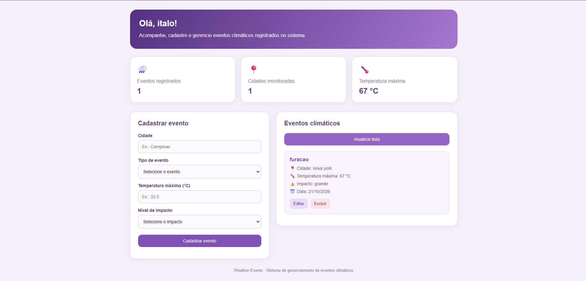
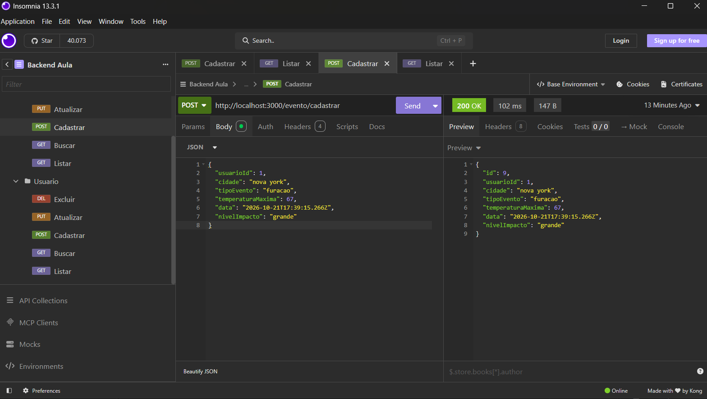
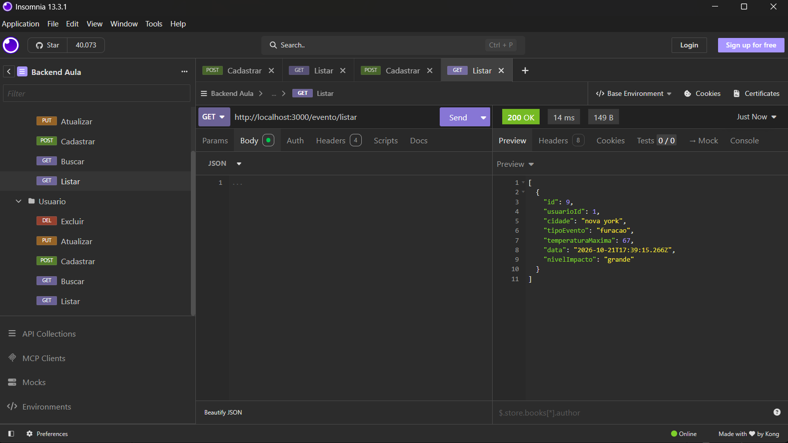
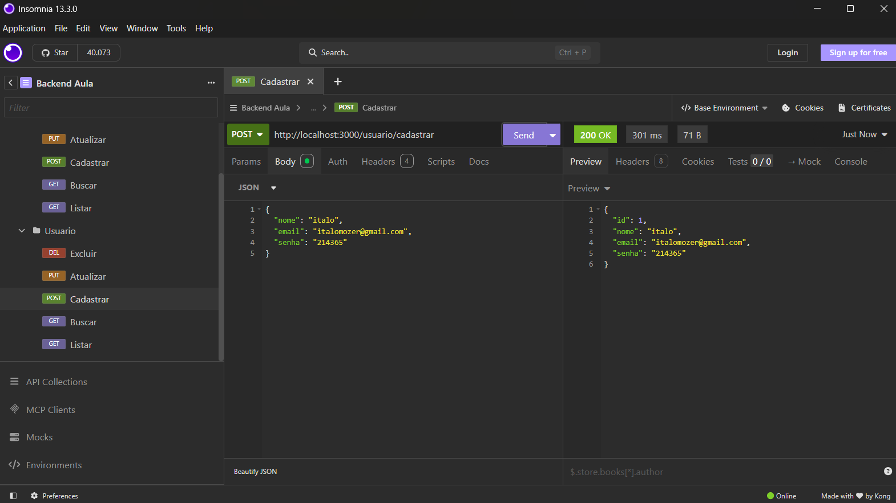
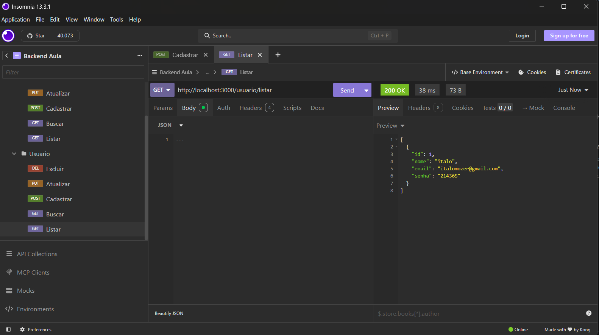

# Sistema de Gerenciamento de Eventos e Usuários

## 📌 Sobre o Projeto

Projeto desenvolvido para a atividade da Aula 05 de PSOF3, do curso Técnico em Desenvolvimento de Sistemas do SENAI.

O sistema apresenta telas relacionadas ao gerenciamento de eventos e usuários.

## 🖥️ Telas do Sistema

### 1. Página Inicial



### 2. Página Principal


### 3. Inserção de Eventos



### 4. Lista de Eventos



### 5. Inserção de Usuários



### 6. Lista de Usuários



## 📂 Estrutura do Projeto

```text
projeto/
├── README.md
└── prints/
    ├── eveINSO.png
    ├── home.png
    ├── index.png
    ├── listaEVE.png
    ├── listaUSU.png
    └── usuINSO.png
```

## 🚀 Como Executar

1. Clone ou baixe o repositório.
2. Abra a pasta do projeto no Visual Studio Code.
3. Configure as dependências necessárias.
4. Execute o projeto conforme as instruções da tecnologia utilizada.


## ✅ Conclusão

Este README documenta as telas da aplicação por meio de imagens, facilitando a visualização e a compreensão do projeto desenvolvido.

## autor

Ítalo mozer de sousa
